# Osteon: AI X-Ray Analysis Engine with a Hybrid Quantum-Classical Model

**Live demo:** https://xray-ai-engine-six.vercel.app/

Osteon is a web app that reads bone X-rays. You upload a radiograph, or pick one of 200 built-in samples, and two different AI systems look at it:

1. **A large vision AI (Google Gemini)** describes what it sees, draws boxes around areas of concern, and rates how serious each one looks.
2. **A small hybrid quantum-classical neural network**, which we built and trained ourselves, gives an independent yes/no estimate of whether the bone is fractured. Its middle layer is a 4-qubit quantum circuit.

> **Disclaimer:** this is an educational project, not a medical device. It can be wrong and must never be used to diagnose anyone.

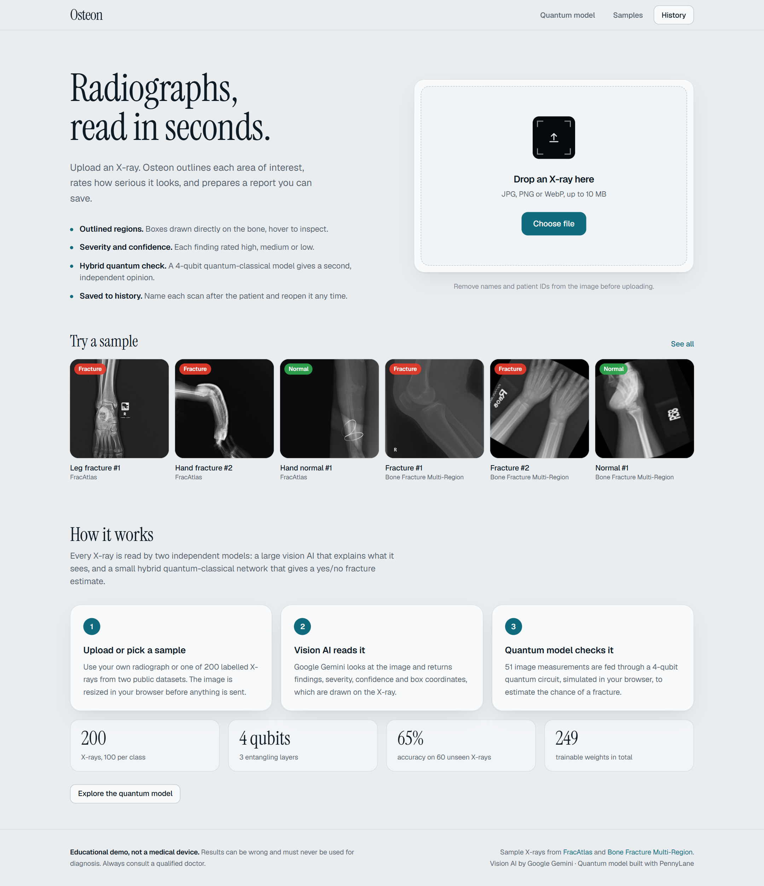

---

## Contents

1. [Quick tour (screenshots)](#1-quick-tour)
2. [The big picture](#2-the-big-picture)
3. [Part A: the vision AI report](#3-part-a-the-vision-ai-report-gemini)
4. [Part B: the dataset](#4-part-b-the-dataset)
5. [Part C: the hybrid quantum-classical model](#5-part-c-the-hybrid-quantum-classical-model)
6. [Results and what they mean](#6-results-and-what-they-mean)
7. [How the quantum model runs inside the website](#7-how-the-quantum-model-runs-inside-the-website)
8. [Project structure](#8-project-structure-what-every-file-does)
9. [Running it yourself](#9-running-it-yourself)
10. [Presentation guide and likely questions](#10-presentation-guide)
11. [Glossary](#11-glossary)
12. [Limitations](#12-limitations)
13. [Credits and references](#13-credits-and-references)

---

## 1. Quick tour

### Home page
Upload an X-ray, try a sample, or read how the system works. The four numbers at the bottom summarise the quantum model.

### Sample gallery
200 labelled X-rays from two public datasets. You can filter by **Fracture / Normal** and by dataset. Each tile also shows whether that image was used to **train** the quantum model or held back to **test** it.

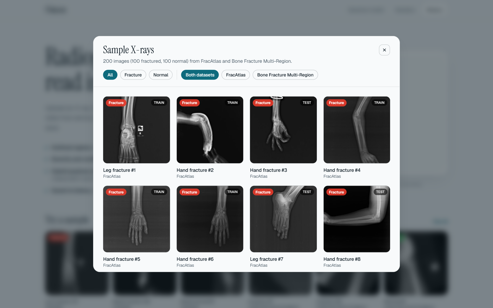

### Analysing
The image is shrunk in the browser and sent to the server, which asks Gemini to analyse it.

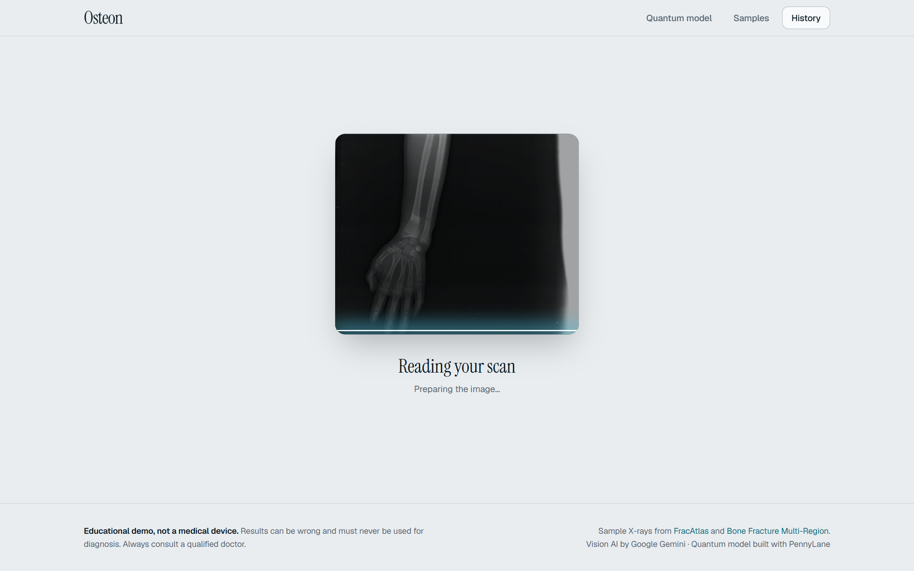

### The result
**Left:** the X-ray with Gemini's boxes drawn on top. Colours show severity: red is high, orange is medium, green is low. For FracAtlas samples, **Compare with radiologist** overlays the boxes drawn by real doctors. **Save image** downloads the annotated picture, and **Download report** downloads a full HTML report.

**Right:** Gemini's summary and the list of findings, each with a severity and a confidence score.

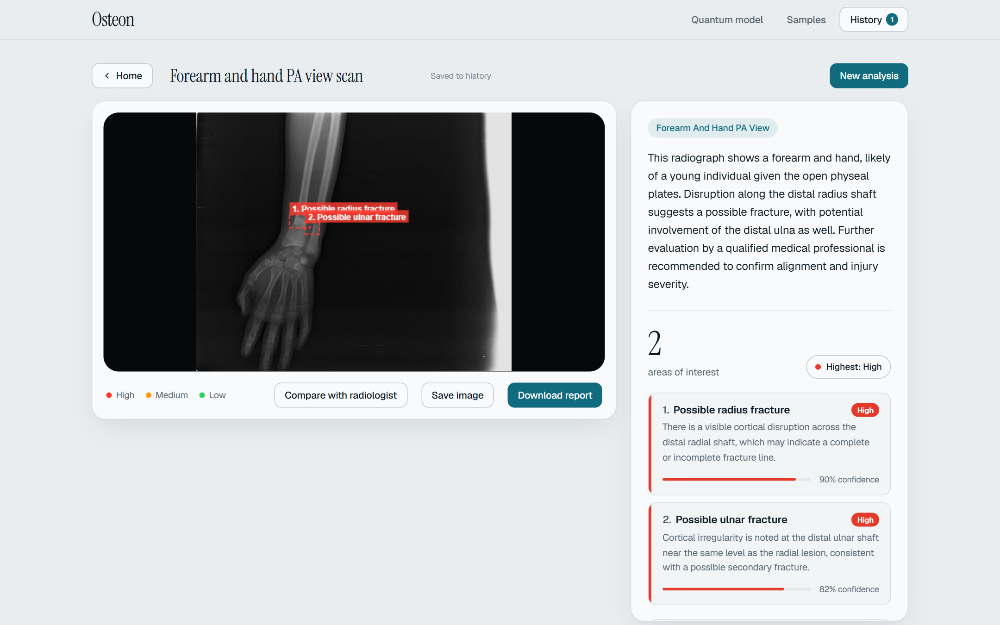

### The hybrid quantum model's opinion
Below Gemini's findings is the quantum model's verdict. In this example it says **Fracture, 78%**, which matches the dataset's label. The panel also shows:
- **Qubit read-out:** the measured value ⟨Z⟩ of each of the 4 qubits, between −1 and +1.
- **Measurement probabilities:** the chance of measuring each of the 16 possible states of 4 qubits, from |0000⟩ to |1111⟩.

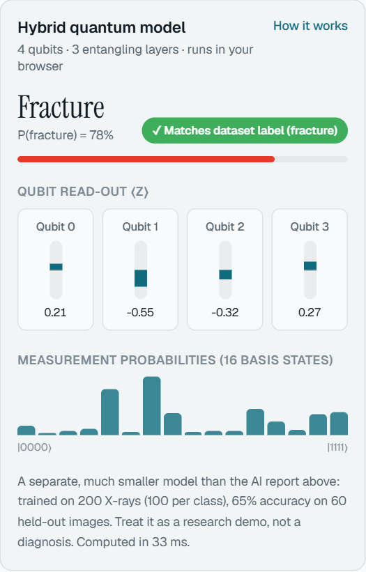

### "Quantum model" explainer
The **Quantum model** button (also **How it works**) opens an explanation with the pipeline, the actual trained circuit, the dataset, and a results table comparing it with classical models.

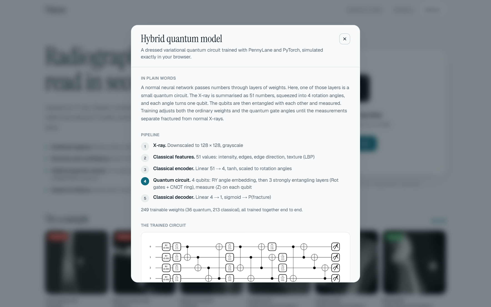

### History
Every analysis is saved in the browser (nothing is stored on a server). Scans can be renamed, reopened or deleted.

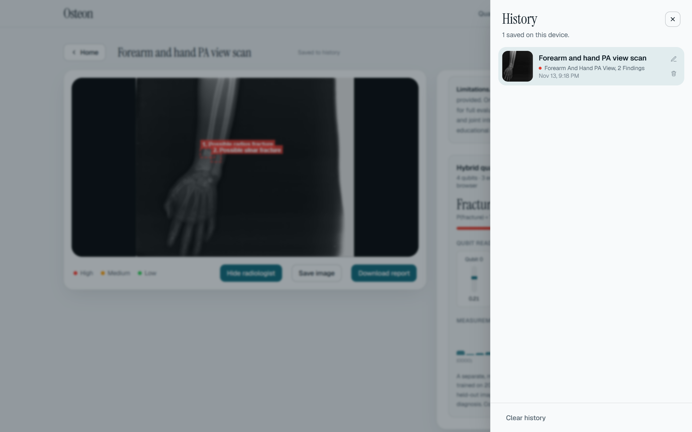

### Works on phones

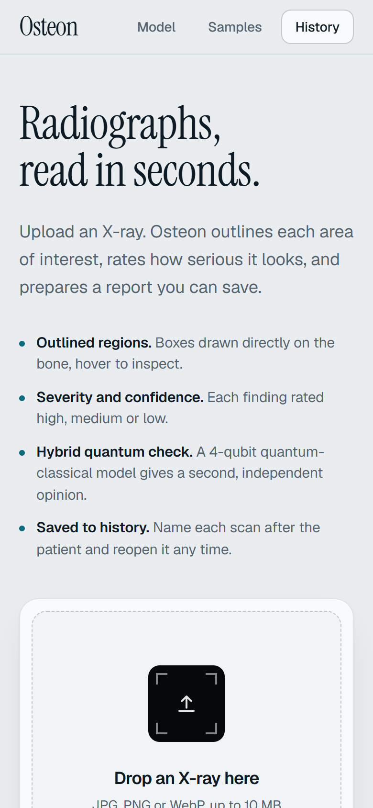

---

## 2. The big picture

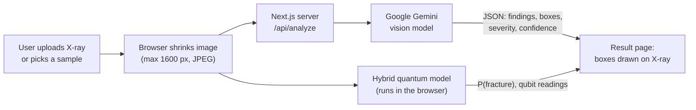

There are **two independent "opinions"**:

| | Vision AI (Gemini) | Hybrid quantum model |
|---|---|---|
| Who made it | Google (huge pre-trained model) | Us (trained on our own 200 images) |
| Size | Billions of parameters | **249** parameters |
| What it outputs | Text, findings, boxes, severity | One number: probability of fracture |
| Where it runs | Google's servers (needs an API key) | Inside your browser (no server, no key) |
| Purpose | Useful, explainable report | Show that a quantum circuit can be part of a working ML model |

**Tech stack:** Next.js 16 (React 19, TypeScript), Tailwind CSS, Framer Motion, the Google Gemini API, and Vercel hosting. The quantum model was trained with Python, PennyLane (quantum ML library), PyTorch and scikit-learn.

---

## 3. Part A: the vision AI report (Gemini)

Step by step, this is what happens when you analyse an X-ray:

1. **Resizing in the browser** (`lib/imageUtils.ts`). The image is redrawn on an HTML canvas at a maximum of 1600 px and saved as JPEG. This makes uploads fast and small.
2. **Sending it to our server** (`app/api/analyze/route.ts`). The browser sends the image to the `/api/analyze` endpoint, which runs as a Vercel serverless function. The Gemini API key lives only on the server, so visitors never see it.
3. **Rate limiting.** Each IP address can make at most 5 requests per minute, to protect the free API quota.
4. **Prompting Gemini.** The server sends the image together with a carefully written instruction ("prompt"). It tells Gemini to:
   - first check whether the image is really an X-ray (if not, return `is_xray: false`),
   - use cautious language ("possible", "may indicate") and never give a definite diagnosis,
   - return **only JSON** in a fixed format: body region, summary, findings (label, description, severity, confidence, box) and limitations.

   The setting `responseMimeType: "application/json"` forces Gemini to reply with machine-readable JSON instead of chat text.
5. **Fallback models with a time limit.** The server tries a list of Gemini models, fastest and most reliable first. If one is overloaded (503), out of free quota (429), retired (404), or too slow, it moves straight to the next one. Vercel stops a request after 60 seconds, so the server keeps its own 50-second deadline and always sends back a proper answer. A normal analysis takes about 5–10 seconds.
6. **If Gemini still fails**, the page doesn't break. It shows a clear message with a **Try again** button, and the quantum model's result is still shown, because that model runs in the browser.
7. **Drawing the boxes** (`components/XrayCanvas.tsx`). Gemini gives box coordinates on a **0–1000 scale** as `[ymin, xmin, ymax, xmax]`. So 500 means "halfway across the image", whatever its real size. The browser converts them to pixels and draws them on a `<canvas>` over the X-ray. The original image is never modified.
8. **Radiologist comparison.** For FracAtlas samples we know where real doctors marked the fracture. The dataset stores these as YOLO boxes (centre x, centre y, width, height, each 0–1), which we converted to the same 0–1000 format so they can be overlaid.
9. **History** (`lib/history.ts`). Results are saved in **IndexedDB**, a database built into the browser. They stay on that device only.

---

## 4. Part B: the dataset

### Requirement
Our mentor asked for **80–100 images per class**. We use **100 fractured + 100 normal = 200 X-rays**.

### Where the images come from

| Dataset | Fractured | Normal | Notes |
|---|---|---|---|
| [FracAtlas](https://www.kaggle.com/datasets/anandhuh/fracatlas) (CC-BY 4.0) | 50 | 50 | Hands, legs, hip. Every fracture has a box drawn by a radiologist. |
| [Bone Fracture Multi-Region](https://www.kaggle.com/datasets/bmadushanirodrigo/fracture-multi-region-x-ray-data) | 50 | 50 | Many body regions. |
| **Total** | **100** | **100** | |

### How the dataset was built (`quantum/prepare_dataset.py`)

The script reads both original dataset ZIP files and:

1. **Downsizes** every image to grayscale JPEG with a maximum side of 512 px. All 200 images together are only **1.9 MB**. The previous version of the project had 35 images taking 27 MB.
2. **Removes duplicates.** The Bone Fracture dataset contains many copies of the same X-ray (rotated or flipped, made for "data augmentation"). The script removes:
   - **exact copies**, found by comparing MD5 file fingerprints;
   - **near copies**, found with a perceptual "average hash": each image is shrunk to 8×8 pixels and turned into a 64-bit pattern, and two images whose patterns differ in 4 bits or fewer count as the same picture.
3. **Removes confusing images**, such as FracAtlas images with metal implants, several scans in one file, or mixed body regions.
4. **Balances body regions.** The normal FracAtlas images are chosen to match the fractured ones (32 hands, 17 legs, 1 hip in each class). Otherwise the model could cheat by learning "legs are usually normal" instead of learning what a fracture looks like.
5. **Splits** the data into **train (70%)** and **test (30%)**: 140 images for training and 60 kept hidden until the final evaluation. The split is *stratified*, meaning each part has the same mix of classes and datasets.
6. Writes `public/samples/manifest.csv` (one line per image: label, dataset, region, split, original file) and `lib/samples.ts` (the list the website uses).

A fixed random seed (42) means running the script again gives exactly the same dataset.

---

## 5. Part C: the hybrid quantum-classical model

### 5.1 Quantum computing in 2 minutes

| Idea | Plain explanation |
|---|---|
| **Qubit** | A normal bit is 0 or 1. A qubit can be in a *mix* (superposition) of 0 and 1, like an arrow that can point anywhere on a sphere. |
| **Rotation gate** (RY, RZ, Rot) | Turns the qubit's arrow by an angle. Angles are the "knobs" we can set or train. |
| **Entanglement** (CNOT gate) | Links qubits together so that one's state depends on another's. This lets the circuit combine information across qubits. |
| **Measurement** ⟨Z⟩ | Reading a qubit gives a number between −1 (definitely 1) and +1 (definitely 0). |
| **4 qubits** | Together they have 2⁴ = **16** possible states (|0000⟩ … |1111⟩), and the circuit works with all 16 at once. |
| **Variational circuit** | A circuit whose gate angles are *trainable weights*, just like the weights of a neural network. |

### 5.2 Why "hybrid"?
Today's quantum computers are small and noisy, so the common approach (called NISQ-era quantum ML) is to let **classical** layers handle the large data and use a **small quantum circuit** as one layer in the middle. The whole network is trained together. Our design is the "dressed quantum circuit" from Mari et al. (2020).

### 5.3 The architecture

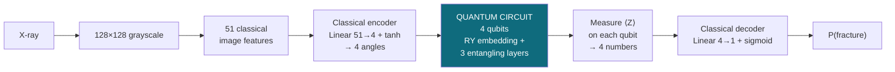

**Step 1: classical features** (`quantum/features.py`). A quantum circuit can't take a whole image, so the X-ray is first summarised as 51 numbers:

| Features | Count | What they capture |
|---|---|---|
| Intensity statistics | 5 | Mean brightness, contrast, and the 10th/50th/90th percentiles |
| Intensity histogram | 8 | How much of the image is dark, mid-grey and bright |
| Edge strength (Sobel filter) | 3 | How many sharp edges there are. Fracture lines create extra edges. |
| Edge direction histogram | 8 | Which way the edges point. Bones are long and straight; breaks add odd angles. |
| Laplacian energy | 1 | Sudden "jumps" in brightness, such as cracks |
| 4×4 edge-density grid | 16 | *Where* in the image the edges are |
| Local Binary Patterns (LBP) | 10 | Fine bone texture: how each pixel compares with its 8 neighbours |

**Step 2: classical encoder.** A linear layer turns the 51 features into 4 numbers. `tanh × π/2` squeezes each number into an angle between −90° and +90°.

**Step 3: quantum circuit (4 qubits, 36 trainable angles).**
- **Angle embedding:** an RY gate rotates qubit *i* by angle *i*. This loads the data into the quantum state.
- **3 strongly entangling layers.** In each layer, every qubit gets a trainable `Rot(φ, θ, ω)` gate (3 angles), then CNOT gates link the qubits in a ring.
- **Measurement:** ⟨Z⟩ is read on each qubit, giving 4 numbers between −1 and +1.

This is the actual trained circuit (the numbers in the boxes are the learned angles):

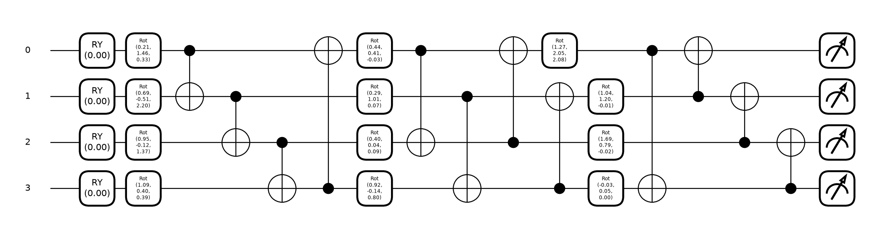

**Step 4: classical decoder.** A linear layer combines the 4 measurements into one number. The sigmoid function turns it into a probability between 0 and 1. Above 0.5 means "fracture".

**Total: 249 trainable weights** (204 + 4 in the encoder, 36 quantum angles, 4 + 1 in the decoder).

### 5.4 Training (`quantum/train_hybrid.py`)
- **Library:** PennyLane's `qml.qnn.TorchLayer` wraps the quantum circuit as a PyTorch layer, so PyTorch can train it like any other layer.
- **Simulator:** `default.qubit`, an exact simulation of the quantum circuit on a normal computer. Gradients (how to adjust each weight) are computed through the circuit by back-propagation.
- **Loss:** binary cross-entropy, the standard loss for yes/no classification.
- **Optimiser:** Adam, learning rate 0.05, 100 full-batch steps (all 140 training images at once per step).
- **Regularisation:** L2 weight decay of 0.05. With only 140 images, this stops the model from just memorising them.
- **Feature scaling:** each feature is standardised (mean 0, std 1) using statistics from the training set only.
- **Fair comparison.** The same script also trains:
  - a **classical twin**: the exact same network, with the quantum layer replaced by a classical `Linear(4→4) + tanh` layer of similar size;
  - **logistic regression**: a simple, standard classical baseline.

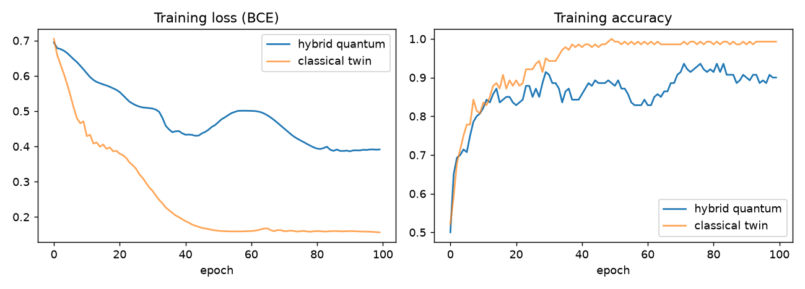

---

## 6. Results and what they mean

### Test set (60 images the model never saw during training)

| Model | Accuracy | Sensitivity | Specificity | AUC | 5-fold cross-validation |
|---|---|---|---|---|---|
| **Hybrid quantum-classical** | **65.0%** | 76.7% | 53.3% | 0.66 | 59.0% ± 3.4 |
| Classical twin | 51.7% | 63.3% | 40.0% | 0.60 | 61.5% ± 5.8 |
| Logistic regression | 63.3% | 66.7% | 60.0% | 0.66 | 64.0% ± 4.6 |

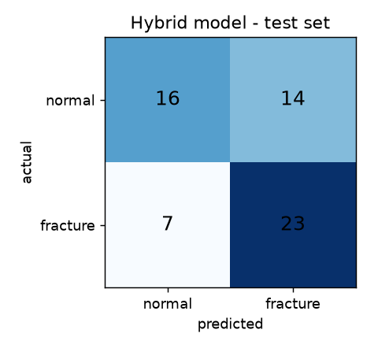

**What the numbers mean:**
- **Accuracy:** the share of all test images classified correctly.
- **Sensitivity (recall):** of the real fractures, how many it caught (23 of 30).
- **Specificity:** of the normal X-rays, how many it correctly called normal (16 of 30).
- **AUC:** how well it ranks fractures above normals; 0.5 is random guessing and 1.0 is perfect.
- **5-fold cross-validation:** the 200 images are split into 5 parts, and the model is trained 5 times, each time tested on a different part. This gives a more reliable average than a single test split.
- **Confusion matrix:** the 2×2 grid above. Rows are the true labels and columns are the predictions.

**Honest interpretation:**
1. On the fixed test set, the hybrid model scored best (65%).
2. In cross-validation, all three models are **within the margin of error** of each other (about 59–64%). So we **do not claim a "quantum advantage"**. The fair conclusion is that a 4-qubit hybrid model is **competitive** with classical models of the same size.
3. **The interesting finding:** look at the training curves. The classical twin **memorised** the training set (99% train accuracy, only 52% on test), while the hybrid model generalised better (89% train, 65% test). The quantum layer is *unitary*: it can only rotate the state, never stretch it, so its outputs are bounded between −1 and +1. That seems to act as a natural **regulariser** that limits overfitting on small datasets.
4. Every model's accuracy is modest. That's expected: detecting fractures from only 100 images per class is very hard. Medical-grade AI models train on tens of thousands of images. The quantum model is a research demonstration; the detailed report comes from Gemini.

---

## 7. How the quantum model runs inside the website

We did **not** connect to a real quantum computer. That would be slow, need an account, and cost money. Instead:

1. After training, the learned weights were saved to `lib/quantum/model.json`.
2. The website includes a small **quantum state-vector simulator** written in TypeScript (`lib/quantum/circuit.ts`). A 4-qubit state is just **16 complex numbers** (amplitudes), and each gate is a small matrix multiplication on them. This is exactly what PennyLane's simulator does, so the browser computes the same answer in about 30 ms.
3. `lib/quantum/features.ts` is a line-by-line port of the Python feature extractor.
4. **Verification:** `npm run check:quantum` runs saved test images through the TypeScript simulator and compares the result with PennyLane's. They agree to about 0.0000000000000001, so the website runs exactly the model that was trained.

---

## 8. Project structure (what every file does)

```
├── app/
│   ├── page.tsx                  Main page: home, analysing screen, results
│   ├── layout.tsx                Fonts, page title
│   ├── globals.css               Colours and design tokens
│   └── api/analyze/route.ts      Server endpoint that calls Gemini
├── components/
│   ├── UploadZone.tsx            Drag-and-drop upload box
│   ├── XrayCanvas.tsx            Draws boxes on the X-ray, report download
│   ├── FindingsList.tsx          List of Gemini's findings
│   ├── QuantumPanel.tsx          The hybrid quantum model's result card
│   ├── ModelInfo.tsx             "Quantum model" explainer dialog
│   ├── SampleGallery.tsx         The 200-sample gallery with filters
│   └── HistoryPanel.tsx          Saved scans
├── lib/
│   ├── quantum/
│   │   ├── features.ts           51-feature extractor (port of features.py)
│   │   ├── circuit.ts            4-qubit state-vector simulator
│   │   ├── hybrid.ts             Forward pass: encoder → circuit → decoder
│   │   ├── classifier.ts         Loads an image and runs the model
│   │   └── model.json            Trained weights + metrics
│   ├── samples.ts                List of the 200 samples (auto-generated)
│   ├── datasets.ts               Dataset names and links
│   ├── history.ts                Saving scans in the browser (IndexedDB)
│   ├── imageUtils.ts             Resizing, box coordinate conversion
│   └── types.ts                  Shared TypeScript types
├── quantum/                      Python: dataset + training
│   ├── prepare_dataset.py        Builds the 100-per-class dataset
│   ├── features.py               Feature extractor
│   ├── train_hybrid.py           Trains + evaluates the hybrid model
│   ├── requirements.txt          Python packages
│   ├── README.md                 Short technical notes
│   └── results/                  metrics.json, charts, circuit diagram
├── public/
│   ├── samples/                  The 200 X-rays + manifest.csv
│   └── model/                    Charts shown in the website
├── scripts/check-quantum.mjs     Verifies browser simulator = PennyLane
└── docs/screenshots/             Images used in this README
```

---

## 9. Running it yourself

### The website
You need [Node.js](https://nodejs.org) 20 or newer and a free Gemini API key from https://aistudio.google.com/app/apikey.

```bash
npm install
cp .env.example .env.local      # then open .env.local and paste your GEMINI_API_KEY
npm run dev                     # open http://localhost:3000
```

**Deploying on Vercel:** import the GitHub repo in Vercel, then add `GEMINI_API_KEY` under *Project Settings → Environment Variables*. Every push to `main` redeploys automatically. The quantum model needs no setup.

### Re-building the dataset and re-training the quantum model (optional)
You need Python 3.10+ and the two dataset ZIP files from Kaggle (links above).

```bash
pip install -r quantum/requirements.txt
python quantum/prepare_dataset.py --fracatlas "path/to/FracAtlas.zip" --bonefx "path/to/Bone Fracture Multi-Region X-ray Data.zip"
python quantum/train_hybrid.py      # about 15 seconds on a laptop
npm run check:quantum               # confirms the website matches PennyLane (needs Node 22.18+)
```

---

## 10. Presentation guide

### Suggested 5-minute demo
1. **Open the live site.** Explain the idea: two independent AI opinions on an X-ray.
2. **Open Samples.** Show that there are 100 fractured and 100 normal images from two public datasets, with train and test tags.
3. **Click a fracture sample from the test set**, for example *Hand fracture #19*. While it loads, explain that the image goes to Gemini via our server.
4. **Show the result.** Point out the boxes and severity, then click **Compare with radiologist** to show the real doctors' boxes.
5. **Scroll to the quantum panel.** Explain: 51 features → 4 angles → 4 qubits → entangled → measured → probability. Point out the qubit read-out and the 16 measurement probabilities.
6. **Open "How it works".** Show the circuit diagram and the results table, and explain the honest conclusion (competitive, less overfitting, no claimed quantum advantage).

### Questions you might be asked

**Q: Is this running on a real quantum computer?**
No. It runs on an exact *simulation* of a quantum computer. With 4 qubits, the simulation is perfect and fast (16 numbers). The same circuit could run on real hardware (IBM, IonQ) through PennyLane, but real hardware adds noise, cost and waiting time.

**Q: Why only 4 qubits?**
Simulating n qubits needs 2ⁿ numbers, and today's real devices are small and noisy. 4 qubits (16 states) is a standard size for hybrid-model research, and it keeps the model small enough for our 140 training images.

**Q: What makes it "hybrid"?**
Classical layers before and after the quantum circuit. The classical part compresses the data into 4 angles and turns the qubit measurements into a probability. All parts are trained together with gradient descent.

**Q: Is the quantum model better than a classical one?**
On our test set it scored highest (65% vs 63% and 52%). But cross-validation shows the models are statistically similar, so we don't claim an advantage. Our interesting observation is that the quantum layer overfits less than an equivalent classical layer.

**Q: Why is the accuracy only 65%?**
Only 100 images per class (as required), and simple image features. Fractures are often tiny cracks. Professional models use thousands of images and large CNNs. We also tested features from pretrained CNNs (ResNet18, EfficientNet, MobileNet): they were not significantly better at this dataset size.

**Q: How did you avoid cheating or data leakage?**
The test images were never used for training or for choosing settings. Duplicates were removed across the whole dataset, and body regions were balanced between classes.

**Q: What is PennyLane?**
An open-source Python library from Xanadu for quantum machine learning. It lets quantum circuits be trained with PyTorch, like neural-network layers.

**Q: What does ⟨Z⟩ mean?**
The average result of measuring a qubit: +1 means it's always 0, −1 means it's always 1, and 0 means 50/50.

**Q: What is Gemini doing, and is it trained by you?**
No. Gemini is Google's pre-trained multimodal model. We only wrote the prompt and the code around it. The quantum model is the part we trained ourselves.

---

## 11. Glossary

| Term | Meaning |
|---|---|
| Radiograph | An X-ray image |
| Class | A category to predict: here *fractured* or *normal* |
| Feature | A number measured from the image (brightness, edges, …) |
| Training / test set | Images the model learns from / images kept hidden to check it |
| Overfitting | Memorising the training images instead of learning general rules |
| Weight decay (L2) | A penalty on large weights that reduces overfitting |
| Sigmoid | Function that turns any number into a probability between 0 and 1 |
| tanh | Function that squeezes any number into the range −1 to 1 |
| Qubit | Quantum bit; can be in a superposition of 0 and 1 |
| Superposition | A qubit being partly 0 and partly 1 at the same time |
| Entanglement | Qubits whose states are linked together |
| CNOT | Two-qubit gate: flips the target qubit if the control qubit is 1 |
| RY / RZ / Rot | Gates that rotate a qubit's state by an angle |
| Expectation value ⟨Z⟩ | Average measurement of a qubit, from −1 to +1 |
| State vector | The full list of 2ⁿ amplitudes describing n qubits |
| Variational circuit | Quantum circuit with trainable gate angles |
| PennyLane | Python library for quantum machine learning |
| Cross-validation | Repeating train/test on different splits for a reliable average |
| AUC | Area under the ROC curve; ranking quality from 0.5 (random) to 1 (perfect) |
| YOLO box | Box format: centre x, centre y, width, height (0–1) |
| IndexedDB | A database built into web browsers |

---

## 12. Limitations
- **Not for medical use.** Both models can be wrong. Gemini can miss fractures or invent findings.
- **Small dataset** (200 images), so accuracy is modest and results vary with the train/test split.
- **Simulated quantum hardware.** No real quantum computer is used. On real hardware, noise would reduce accuracy.
- **Gemini availability.** The app uses a free Gemini API key, which has daily limits per model. When Google's servers are busy or the quota runs out, the AI report can fail; the app then shows a Try again button and still shows the quantum result. Quotas reset every day.
- **Privacy.** Images are sent to Google's Gemini API for analysis. Remove names and IDs from images before uploading.

---

## 13. Credits and references
- **FracAtlas:** Abedeen et al. (2023), *FracAtlas: A Dataset for Fracture Classification, Localization and Segmentation of Musculoskeletal Radiographs*, Scientific Data. CC-BY 4.0.
- **Bone Fracture Multi-Region X-ray Data:** bmadushanirodrigo, Kaggle.
- **Dressed quantum circuits:** Mari, A., Bromley, T. R., Izaac, J., Schuld, M., Killoran, N. (2020), *Transfer learning in hybrid classical-quantum neural networks*, Quantum 4, 340.
- **Strongly entangling layers:** Schuld, M., Bocharov, A., Svore, K., Wiebe, N. (2020), *Circuit-centric quantum classifiers*, Physical Review A 101, 032308.
- **PennyLane:** Bergholm et al. (2018), *PennyLane: Automatic differentiation of hybrid quantum-classical computations*, arXiv:1811.04968.
- **Vision AI:** Google Gemini API.
